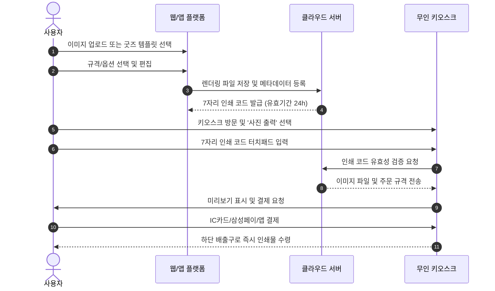

# 01. 기존 참고 서비스(프린팅박스) 분석 보고서

## 1. 조사 개요
- **대상 서비스**: 프린팅박스 (Printingbox, https://printingbox.kr/) 및 관련 콘텐츠박스
- **조사 목적**: 웹/모바일 사용자 동선, 무인 출력 코드 발급 메커니즘, 굿즈/인화 서비스 흐름 분석
- **조사 일시**: 2026-10-26
- **조사 방식**: 공개 웹사이트 및 사용자 매뉴얼, 이용 가이드 및 UI/UX 분석

---

## 2. 기존 서비스 핵심 기능 및 구조 분석

### 2.1 주요 기능 및 서비스 영역
1. **문서 출력 (A4)**:
   - PDF, HWP, MS Office, 이미지 파일 업로드
   - 흑백(100원/장), 컬러(300원/장)
2. **사진 인화 (Photo Print)**:
   - 4x6(1,000원), 6x8(2,000원), 증명/여권(2,000원)
   - 분할 인쇄(추억8컷, 포토달력 등)
3. **크리에이터/IP 굿즈 (콘텐츠박스 연동)**:
   - 작가/팬덤이 업로드한 이미지에 대해 일회성 인쇄 코드를 발급받아 공유
   - 팬들은 해당 7자리 인쇄 코드를 가지고 전국 키오스크에서 현장 출력

### 2.2 사용자 동선 (User Flow)

---

## 3. 웹·모바일 UI/UX 및 인터랙션 분석

1. **레이아웃 특성**:
   - 상단 내비게이션 바: 서비스 소개, 이용안내, 지점 찾기, 이벤트, 고객센터
   - 메인 비주얼: 키오스크 검색 및 7자리 코드 빠른 입력 위주 구성
   - 모바일 최적화: 모바일 웹 및 하이브리드 앱 기반으로 단일 컬럼 카드 UI 적용
2. **굿즈 편집 인터랙션의 한계**:
   - 기존 서비스는 정밀한 WYSIWYG 웹 편집기보다는 '단순 이미지 업로드'와 사전 제작된 정적 프레임 결합 위주
   - 웹툰 공식 캐릭터 에셋 팔레트, 스티커 자유 배치, 텍스트 타이포그래피, 300DPI 인쇄 안전영역(Bleed) 실시간 가이드 부재

---

## 4. 기술 정보 및 외부 연동 구분 (사실 vs 추정)

| 구분 | 항목 | 확인된 사실 (Fact) | 추정 및 미확인 사항 (Assumption) |
| :--- | :--- | :--- | :--- |
| **코드 발급** | 인쇄 코드 | 7자리 고유 난수 코드, 유효기간 24시간 | 내부 해시 알고리즘 또는 시퀀스 테이블 매핑 방식 |
| **키오스크 H/W** | 출력 장비 | 염료승화형 포토프린터 + A4 레이저 복합기 | 상세 벤더사(DNP, Sindoh 등) 기종별 SDK 제어 프로토콜 |
| **통신 프로토콜**| 기기-서버 통신 | 코드 입력 시 서버 실시간 검증 후 파일 다운로드 | 웹소켓/MQTT 기반 푸시인지 REST 폴링 방식인지 여부 |
| **결제 방식** | 요금 수납 | 키오스크 단말기 IC/MS 리더기 현장 결제 | 오프라인 VAN/PG사 다이렉트 통신 모듈 세부 인터페이스 |
| **보안/삭제** | 파일 보관 | 유효기간 경과 시 클라우드 서버에서 파일 자동 파기 | 스토리지 수명주기(Lifecycle) 및 무중단 파기 주기 |

---

## 5. TOON CANVAS 플랫폼의 차별화 및 신규 구축 방향
1. **독창적 디자인 시스템**: 기존 사이트의 색상, 폰트, 마크업을 전혀 복제하지 않고, K-웹툰 특유의 비비드하면서도 세련된 다크/라이트 인디고 테마 적용
2. **전문 굿즈 스튜디오(WYSIWYG)**: 캔버스 기반 회전/확대축소/레이어 정렬/인쇄 가이드(Bleed, Trim, Safe Zone) 완비
3. **온오프라인 옴니채널**: 7자리 키오스크 즉시 출력(확장된 72시간 유효기간) + 전문 인쇄소 프리미엄 택배 배송 병행
4. **가상 시뮬레이터 제공**: 실제 하드웨어 연결 전 웹 상에서 100% 동일한 터치 키오스크 인터랙션 및 결제/인쇄 모의 테스트 기능 내장
