# 04. 정보 구조도 (Information Architecture)

## 1. 전체 사이트맵 및 계층 구조

```mermaid
graph TD
    Root["TOON CANVAS (루트)"]
    
    %% Main
    Root --> Main["메인 홈 (/)"]
    Main --> Hero["히어로 비주얼 & 추천 배너"]
    Main --> QuickCode["7자리 키오스크 코드 빠른 조회"]
    Main --> BestIPs["인기 웹툰 IP 랭킹"]
    Main --> GoodsTypes["카테고리별 추천 굿즈"]
    
    %% Store
    Root --> Store["웹툰 IP 스토어 (/store)"]
    Store --> StoreList["작품 전체 목록 & 검색/필터"]
    Store --> StoreDetail["작품 상세 (/store/:ipId)"]
    StoreDetail --> CharList["캐릭터 소개 및 에셋 목록"]
    StoreDetail --> ProdGrid["제작 가능 굿즈 규격 & 가격표"]
    
    %% Editor
    Root --> Editor["굿즈 커스텀 에디터 (/editor)"]
    Editor --> Canvas["WYSIWYG 2D 캔버스"]
    Editor --> AssetDrawer["에셋 드로어 (캐릭터/스티커/프레임/말풍선)"]
    Editor --> TextControls["텍스트/폰트 설정"]
    Editor --> PrintGuide["인쇄 규격 가이드 (재단선/안전선/DPI)"]
    Editor --> SaveExport["임시저장 & 최종 렌더링"]
    
    %% Checkout & Order
    Root --> Checkout["주문 및 결제 (/checkout)"]
    Checkout --> OrderSummary["주문 상품 및 후가공 옵션"]
    Checkout --> FulfillmentChoice["수령 방식 (키오스크 즉시 vs 택배)"]
    Checkout --> TestPG["가상 PG 결제 모달"]
    Checkout --> OrderComplete["주문 완료 & 인쇄코드 (/order/complete/:id)"]
    
    %% Kiosk
    Root --> Kiosk["키오스크 시뮬레이터 (/kiosk)"]
    Kiosk --> Keypad["가상 터치 키패드 (7자리 코드)"]
    Kiosk --> PreviewVerify["인쇄 데이터 검증 & 미리보기"]
    Kiosk --> PrintAnim["출력 공정 애니메이션 & 영수증"]
    
    %% MyPage
    Root --> MyPage["마이페이지 (/mypage)"]
    MyPage --> ProjectsTab["내 디자인 보관함 (재편집/삭제)"]
    MyPage --> OrdersTab["주문/출력 내역 (코드 확인/배송 추적/환불)"]
    
    %% Admin
    Root --> Admin["운영자 백오피스 (/admin)"]
    Admin --> DashboardTab["종합 현황 대시보드"]
    Admin --> IPAdminTab["웹툰 IP 및 공식 라이선스 관리"]
    Admin --> OrderAdminTab["주문 및 출력/배송 관리"]
    Admin --> SettlementTab["IP별 판매 정산 대시보드"]
```

---

## 2. 네비게이션 및 메뉴 시스템
1. **글로벌 GNB (Global Navigation Bar)**:
   - 로고 (TOON CANVAS)
   - 웹툰 스토어 (`/store`)
   - 굿즈 제작소 (`/editor`)
   - 키오스크 출력 (`/kiosk`)
   - 마이페이지 (`/mypage`)
   - 관리자 모드 (`/admin`)
   - 사용자 역할 전환 스위처 (팬 / 작가 / 관리자 원클릭 전환)
2. **모바일 바텀 네비게이션 / 햄버거 메뉴**:
   - 모바일 뷰포트에서 하단 탭바 또는 슬라이드 드로어로 직관적인 원핸드 조작 지원
3. **상태 알림 및 피드백**:
   - 상단 토스트 알림 (프로젝트 저장 완료, 주문 접수, 유효기간 알림)
