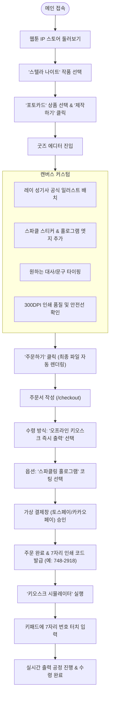
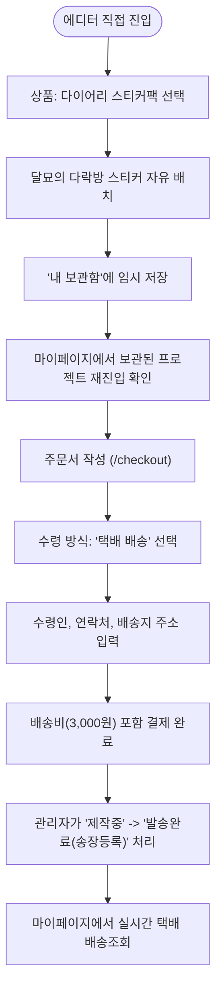
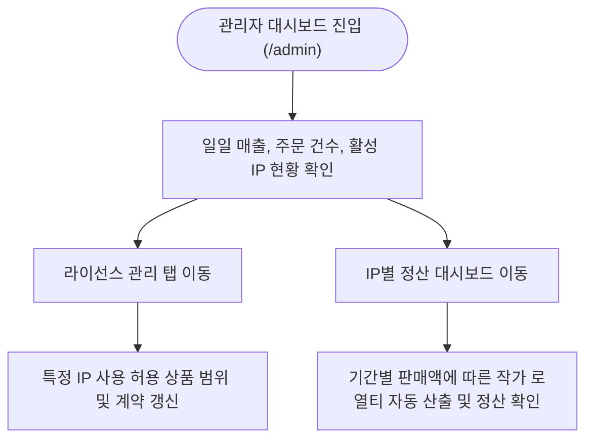

# 05. 사용자 흐름 및 핵심 여정 (User Flow)

## 1. 사용자 유형 (User Personas)
1. **일반 팬 (FAN / USER)**:
   - 좋아하는 웹툰의 공식 에셋을 활용해 세상에 하나뿐인 포토카드나 엽서를 직접 디자인하고, 근처 편의점 키오스크에서 즉시 출력하거나 택배로 수령하고자 함.
2. **웹툰 작가 / 크리에이터 (CREATOR)**:
   - 본인 IP의 라이선스 현황과 팬들의 굿즈 제작량, 발생한 판매 로열티 정산 금액을 확인하고자 함.
3. **플랫폼 총괄 관리자 (ADMIN)**:
   - 공식 라이선스 계약 기간, 상품 규격 및 단가, 전체 주문 및 배송 상태, 키오스크 출력 로그를 모니터링하고 제어함.

---

## 2. 핵심 사용자 여정 (User Journeys)

### 2.1 여정 A: 웹툰 탐색부터 키오스크 즉시 출력까지

### 2.2 여정 B: 다이어리 스티커팩 디자인 및 택배 배송 수령

### 2.3 여정 C: 운영자의 IP 라이선스 관리 및 판매 정산

