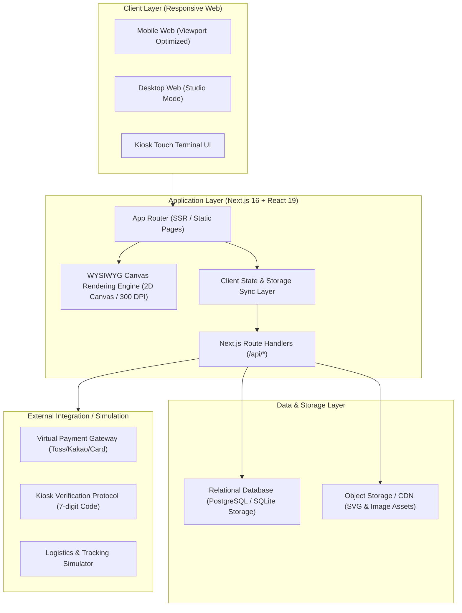

# 08. 시스템 아키텍처 (System Architecture)

## 1. 아키텍처 개요
TOON CANVAS 플랫폼은 모바일 웹 우선의 반응형 웹 애플리케이션으로 설계되었으며, 웹툰 IP 저작권 보호, 초고속 굿즈 렌더링, 오프라인 무인 키오스크 7자리 코드 검증을 원활하게 지원하도록 다계층 아키텍처(Multi-tier Architecture)를 채택합니다.

---

## 2. 계층별 기술 스택 및 역할
1. **Frontend / UI**:
   - Next.js 16.4.3 (App Router), React 19.3.0
   - Tailwind CSS v4, Lucide React 아이콘
   - 커스텀 HTML5 Canvas 2D 엔진 (드래그, 리사이즈, 회전, 레이어 z-index, 가이드 오버레이)
2. **Backend / API**:
   - Next.js API Routes (Serverless Handlers)
   - 입력값 검증 (Zod 및 Strict TypeScript 타입 가드)
   - 결제 금액 무결성 검증 로직
3. **Storage & Database**:
   - 로컬 영속화 레이어: 브라우저 LocalStorage 및 인메모리 API 스토어 (서버리스 환경 즉시 구동 및 완벽한 E2E 테스트 보장)
   - PostgreSQL/SQLite 스키마 호환 엔티티 구조 설계
4. **시뮬레이션 모듈**:
   - Kiosk 시뮬레이터: 실제 편의점 키오스크 7자리 코드 입력 터치패드 및 인쇄 공정 모의 시뮬레이터
   - PG 결제 시뮬레이터: 토스페이, 카카오페이, 카드사 트랜잭션 시뮬레이션
