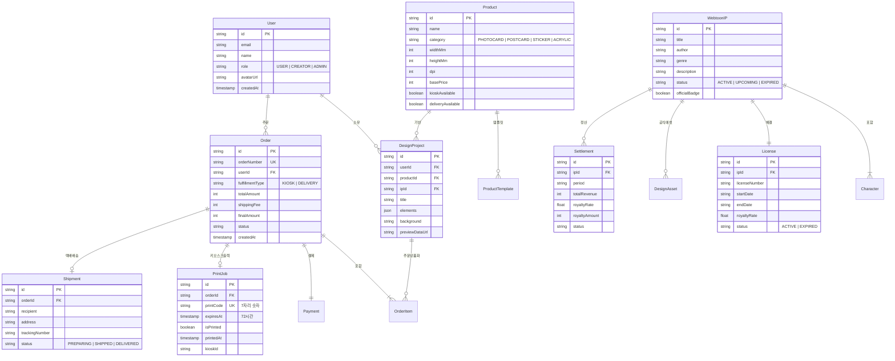

# 09. 데이터베이스 스키마 및 모델 명세 (Database Schema)

## 1. 개체-관계 다이어그램 (ERD)

---

## 2. 테이블 정의서 및 무결성 제약

### 2.1 WebtoonIP & License
- `WebtoonIP`: 작가/제작사 명의, 장르, 공개 상태. `status`가 'ACTIVE'인 작품만 스토어 및 에디터에 노출.
- `License`: 계약 시작/종료일, 로열티율(예: 0.15 = 15%). 만료일 도래 시 상품 에디터 노출 차단.

### 2.2 DesignProject & Product
- `Product`: 인쇄 규격(가로x세로 mm), 해상도(DPI, 기본 300), 재단 여백(BleedMm, 기본 2mm), 안전 여백(SafeMarginMm, 기본 3mm).
- `DesignProject`: 캔버스 상의 모든 오브젝트(캐릭터, 스티커, 텍스트, 프레임)의 위치/크기/회전/레이어 정보가 `elements(JSON)` 컬럼에 직렬화되어 저장됨.

### 2.3 Order, PrintJob, Shipment
- `PrintJob`: 7자리 인쇄 코드(`printCode`)는 유니크 인덱스를 가지며, `expiresAt`은 주문 생성일시 + 72시간으로 자동 설정됨. `isPrinted`가 true로 변경되면 재출력이 원천 차단됨.
- `Shipment`: 택배 배송 주문에 한해 생성되며 운송장 번호(`trackingNumber`)와 배송 상태를 추적함.
