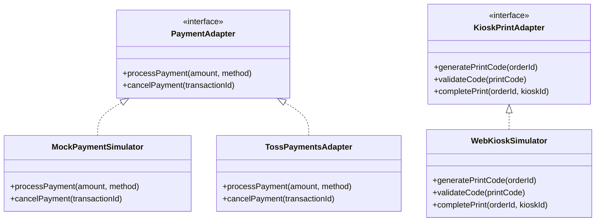

# 12. 외부 시스템 연동 계획 및 경계 명세 (Integration Plan)

## 1. 외부 연동 구성 및 경계 요약

| 외부 시스템 | 연동 대상 및 기관 | MVP 구현 방식 | 상용 전환 시 필요한 요구조건 |
| :--- | :--- | :--- | :--- |
| **전자 결제 (PG)** | 토스페이먼츠, 카카오페이, 네이버페이, 카드사 | **테스트 모드 가상 결제창 시뮬레이터** | 법인 사업자등록증, 통신판매업 신고, PG사 심사 및 가맹점 MID/SecretKey 연동 |
| **무인 출력 키오스크** | CU, GS25, 대형마트 무인 포토프린터 키오스크 | **7자리 코드 발급 + 웹 키오스크 시뮬레이터** | 키오스크 벤더사 H/W 전용 Windows 단말기 드라이버 및 양방향 WebSocket/REST API 규격서 협의 |
| **물류/택배사** | CJ대한통운, 우체국택배, 롯데택배 | **가상 운송장 번호 생성 및 배송 파이프라인 관리** | 택배사 기업 계약 및 EDI/API (운송장 채번, 집하 요청, 배송 추적) 연동 |
| **이미지 스토리지/CDN** | AWS S3 / Cloudflare R2 | **인라인 DataURL & 로컬/클라우드 가상 객체 스토리지** | S3 버킷 생성, IAM 액세스 키, CDN(Cloudflare/CloudFront) 도메인 연결 |
| **전문 인쇄소 (Print-on-Demand)** | 디지털 인쇄/칼선 스티커 전문 제작 공장 | **300 DPI 고해상도 인쇄 렌더링 파일 생성** | 인쇄소 Web-to-Print API 또는 규격화된 PDF/CMYK 자동 업로드 SFTP 파이프라인 |

---

## 2. 연동 인터페이스 모듈화 아키텍처

코드베이스 내에서 외부 연동 인터페이스는 언제든지 실제 SDK로 교체될 수 있도록 어댑터 패턴(Adapter Pattern)을 준수합니다.

