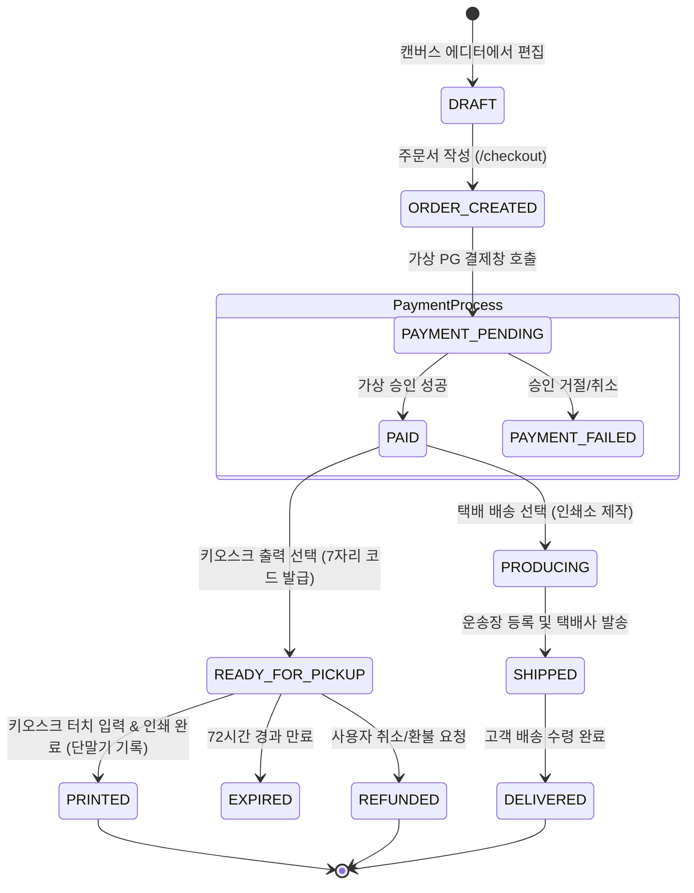

# 16. 주문·결제 및 무인 키오스크 출력 파이프라인 명세 (Payment & Print Flow)

## 1. 결제 및 출력 파이프라인 상태 전이 다이어그램

---

## 2. 모듈별 검증 및 테스트 시나리오

### 2.1 시나리오 1: 7자리 인쇄 코드 발급 및 키오스크 출력
1. **발급 검증**: 주문 완료 시 7자리 난수(예: `748-2918`)가 고유하게 발급되며 유효기간 72시간 타이머가 시작됨.
2. **코드 조회 검증**: `/kiosk` 시뮬레이터에서 7자리 입력 시 서버에서 정확한 주문 상품, 옵션, 고화질 렌더링 파일 확인.
3. **출력 공정 시뮬레이션**: '인쇄 시작' 버튼 클릭 시 롤러/프린터 진행률(0% -> 100%) 시뮬레이션 후 하단 배출구로 배출.
4. **일회성(Single-use) 재사용 차단 검증**: 출력이 완료된 후 동일한 코드를 재입력하면 "이미 출력이 완료된 코드입니다" 에러 안내 표시.

### 2.2 시나리오 2: 택배 배송 및 관리자 운송장 등록
1. 택배 배송 선택 시 배송비(3,000원) 자동 가산 및 주소지 필수 입력 확인.
2. 결제 완료 후 마이페이지에서 '배송 준비 중' 상태 확인.
3. `/admin` 백오피스에서 운송장 번호 입력 시 '배송중' 및 운송장 번호 실시간 동기화 확인.

### 2.3 시나리오 3: 출력 전 취소 및 환불
1. 키오스크 출력 전 상태에서 마이페이지 '취소/환불' 버튼 클릭 시 즉각 환불 처리 및 발급 코드 무효화.
